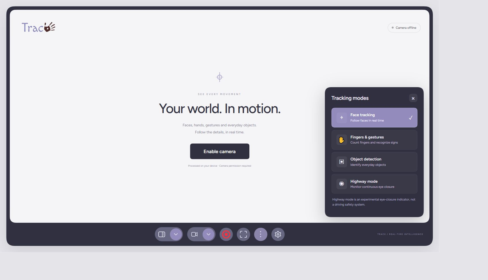

# Track



A browser-based vision studio with a clean lavender interface. Track faces, hands, fingers, gestures and everyday objects using your camera. Video inference runs locally in your browser.

## Quick start

Install [Node.js 22 or newer](https://nodejs.org/), clone this repository, then run:

```sh
git clone https://github.com/Lucas719-bit/Track.git
cd Track
npm start
```

Open **http://localhost:5173** in Chrome or Edge and select **Enable camera**. No build step, API key, or npm package installation is required. Allow camera permission when prompted.

## Modes

| Mode | Features |
| --- | --- |
| Face tracking | Face bounding box without a visible facial mesh |
| Fingers & gestures | Two-hand tracking, finger counting, red landmark joints and gesture labels |
| Object detection | Bounding boxes and confidence for supported everyday objects |
| Highway | Experimental continuous eye-closure alert with live blink scores and a countdown |

Gestures include peace, thumbs up/down, rock on, I love you, fist, open palm and pointing. Some signs use landmark geometry; this is not full sign-language recognition. Accuracy varies with pose, lighting and visibility.

## Controls

- **Logs:** view or clear the current session's events.
- **Record:** save the tracking canvas; use the adjacent menu for screen/window recording or a PNG screenshot. Recordings do not include audio.
- **Pause:** freeze the displayed tracking frame; press again to resume.
- **Fullscreen:** expand the app.
- **Mode menu:** select a detector. Click outside a panel or press Escape to dismiss it.
- **Settings:** theme, app size, overlay color, mirror camera, eye-closure delay and threshold. Disconnect releases the camera.

Settings are saved in browser local storage. Logs stay in memory. Downloads are saved through your browser.

## Highway mode

Enable the camera, choose Highway mode, and keep your face clearly visible. The status displays left/right blink confidence and closure duration. An alert appears after both eyes remain closed for the selected delay (1.5 seconds by default). Separate closing/reopening thresholds reduce score jitter. Adjust sensitivity in Settings; lower thresholds are more sensitive.

This experimental feature is **not a certified driver-monitoring or safety system**. Test while stationary; do not depend on it to prevent drowsy driving. Live accuracy requires testing with your own camera and lighting.

## Dependencies and network access

There are **no npm runtime dependencies**. Node's built-in HTTP server serves the app.

| Dependency | Delivery / purpose |
| --- | --- |
| MediaPipe Tasks Vision 0.10.21 | JavaScript and WASM from jsDelivr; face, hand and object inference |
| MediaPipe model assets | Google Cloud Storage; downloaded when a mode is first used |
| Figtree | Google Fonts stylesheet and font files |
| Browser APIs | getUserMedia, Canvas, MediaRecorder, getDisplayMedia, Fullscreen |

Internet access is required to fetch libraries, models and fonts. Camera frames are processed locally; the app contains no video-upload endpoint. Third-party asset hosts receive ordinary asset requests. Screen capture support varies by browser. Hosted deployments require HTTPS; localhost is supported for development.

## Development and verification

```sh
npm test
npm run check
```

Tests cover the eye-closure timer, confidence hysteresis, missing-face/one-eye behavior and gesture patterns. They do not establish real-world detector accuracy or end-to-end recording compatibility.

| File | Purpose |
| --- | --- |
| index.html | App shell, embedded logo and toolbar icons |
| style.css | Figtree typography, themes, responsive layout and panels |
| app.js | Camera lifecycle, model loading, overlays, recording and controls |
| tracking.js | Finger geometry, gesture labels and eye-closure state |
| tracking.test.js | Node test suite |
| server.mjs | Local static server, bound to 127.0.0.1:5173 |

## Troubleshooting

- **Camera denied:** allow access in browser site settings, then retry.
- **Model will not load:** check internet access and whether jsDelivr or Google Storage is blocked.
- **No highway alert:** check live L/R scores, lighting and threshold; ensure the camera is not paused.
- **Port 5173 occupied:** stop another Track server before running npm start.
- **Screen recording unavailable:** use a current desktop Chrome/Edge and select a screen/window in the browser picker.

## Credits and rights

Detection uses [Google MediaPipe](https://developers.google.com/mediapipe). Figtree is distributed through [Google Fonts](https://fonts.google.com/specimen/Figtree). The project logo and supplied toolbar icons were provided by the project owner. Third-party assets retain their respective licenses. No open-source license is granted for this repository yet.
